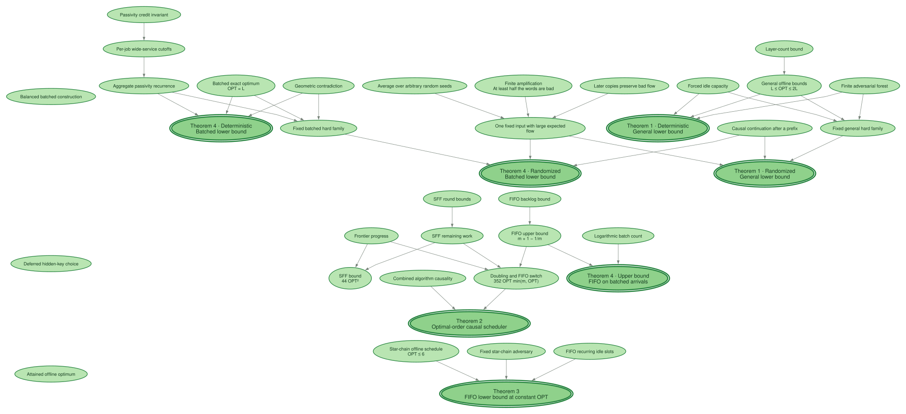

# Non-Clairvoyant Scheduling is Hard Even for Trees

The four main theorems—**Theorems 1, 2, 3, and 4**—are formalized in Lean.

[Paper](https://arxiv.org/abs/2610.11006v1) by Kunal Agrawal, Owen Druzgal, Milind Prabhu,
and Jinhao Zhao.

## Explore the proof

Download the [interactive proof graph](blueprint/generated/Nonclairvoyant_Scheduling_Blueprint.html) and open it in a browser.
Click a theorem or lemma to see its Lean statement, proof, and dependencies.

[](blueprint/generated/Nonclairvoyant_Scheduling_Blueprint.html)

## Build and verify

Install [elan](https://github.com/leanprover/elan), clone this repository, and run:

```bash
lake exe cache get
bash verify.sh
```

Lean and mathlib are pinned to **4.33.0**. Verification builds the proofs
and runs the axiom audit.

See the [formalization notes](FORMALIZATION.md) for theorem statements, assumptions,
and scope.

This formalization was achieved using **ChatGPT-6 Astra**.
